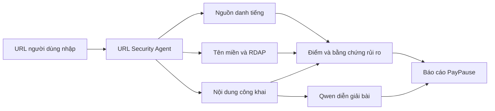

# Nhật ký trạng thái

Mỗi ngày thêm một mục ở cuối bằng `/daily-standup <ngày>`. Không sửa mục của ngày trước.

## Ngày 0 — cài bộ kit
- Đã xong: thêm bộ kit vào repo, chạy `python3 tests/test_kit_scripts.py`
- Việc ngày mai: G0 — chốt brief, taxonomy, 50 mẫu, repo + CI

## Ngày 1 — 2026-11-24 · chốt đề (hướng tới G0 21:00)

**Đã xong (có bằng chứng)**
- PM: `docs/PRODUCT_BRIEF.md` đủ 7 mục. Persona chính = người giao dịch online 20–40 (50+ là phụ). Luồng demo chính = **ảnh chụp tin nhắn**, 6 bước. **Must 7 mục** (thêm M7 tra bằng chứng: blacklist + `domain_check` + Safe Browsing). Should: S1 QR sạch, S2 link chia sẻ tóm tắt 2 câu (bot Telegram → Could). Mục 1 có 2 số liệu kèm nguồn (Bộ Công an/VietNamNet 6.000 tỷ 11T/2025; SIMO/CafeF 28/9/2026).
- PM: `docs/DECISIONS.md` +19 dòng. `docs/TASKS.md` mới: chia việc ngày 2 + hợp đồng nối việc.
- eval-qa: **`run_eval.py` gửi được ảnh** dạng `{text, image_base64, image_mime}`, báo cáo tách `p95_text`/`p95_image`. Bằng chứng: **16 test pass** (`tests/test_kit_scripts.py`).
- PM: sửa 4 chỗ lệch do đổi mốc p95 — `.claude/skills/gate-check/SKILL.md` (p95 6s/12s), `.claude/hooks/session-context.sh` (`p95_text`/`p95_image`), đường dẫn `.claude/skills/eval-harness/dataset-guide.md`, `CLAUDE.md` thêm dòng Windows.
- PM xác nhận 4 điểm eval-qa đề xuất: bỏ `image_url` · p95 tách 6/12s · ảnh hỏng trả 4xx không trả `low` · `transcript` không gửi analyzer.

**Quyết định lớn trong ngày**
- Mốc độ trễ **tách theo loại đầu vào**: văn bản p95 ≤ 6s, ảnh p95 ≤ 12s (thay cho 8s chung).
- `POST /v1/analyze` dùng **JSON base64, KHÔNG multipart**; ảnh ≤ 5 MB; 413/415 kèm thông báo tiếng Việt.
- FE **nén ảnh ở trình duyệt** (cạnh dài ≤ 1600px, JPEG) trước khi gửi.
- Nối việc bằng **stub `analyze(text, image, mime)`** commit trước **10:00 ngày 2**, không nối bằng tài liệu.
- Rủi ro #1 toàn dự án: sập/hết quota lúc BGK thử → bắt buộc có "chế độ hạn chế" (ngày 11).

**Còn nợ của G0 (chưa có bằng chứng, chốt trước 21:00)**
- AI: taxonomy đối chiếu 25 kịch bản + `prompts/analyzer_v0.md`
- BE: repo + CI xanh + `.env.example`
- FE: 3 màn tĩnh chạy local
- QA: ≥ 50 mẫu trong `eval/dataset.jsonl`

**Việc ngày mai (chi tiết: `docs/TASKS.md`)**
- Mục tiêu duy nhất: URL public → tải 1 ảnh chụp tin nhắn → kết quả đúng schema trên thẻ, < 10 giây.
- Giờ cứng: 09:30 xác nhận hợp đồng · **10:00 stub `analyze()`** · 14:00 URL API staging.

---

## `/gate-check G0` — 2026-11-24 · KẾT LUẬN: **CHƯA ĐẠT** (1/4 tiêu chí PASS)

Người kiểm: gate-check (độc lập, chỉ tính bằng chứng chạy được).

| Tiêu chí | PASS/FAIL | Bằng chứng |
|---|---|---|
| `docs/PRODUCT_BRIEF.md` đủ: vấn đề, persona, luồng chính, Must, chỉ số, ngoài phạm vi | **PASS** | Đọc file (162 dòng, sửa 19:47): §1 vấn đề có 2 số liệu kèm link nguồn · §2 bảng 3 persona (P1 chính) · §3 luồng 6 bước BGK tự thử · §4 Must M1–M7 + Should S1/S2 + Could + **Won't (ngoài phạm vi)** · §5 chỉ số có cổng số (recall ≥ 0.90, FPR ≤ 0.10, p95 văn bản ≤ 6s / ảnh ≤ 12s, ≥ 10 người thật) · §6 câu hỏi BTC · §7 rủi ro R1–R6 |
| `.claude/skills/scam-analyzer/taxonomy.md` đã đối chiếu 25 kịch bản (hoặc ghi rõ chưa tìm được) | **FAIL** | `stat` → mtime `18:09:21` = **y nguyên giờ cài bộ kit**, không có một lần sửa nào trong ngày 1. Dòng 5 vẫn là câu của bộ kit: "**Việc của ngày 1:** tìm thông báo gốc, đối chiếu và bổ sung đủ 25 mã kịch bản" → việc chưa làm, không phải kết luận "chưa tìm được". Đếm mã kịch bản con: G1=6, G2=4, G3=4, G4=5, G5=5 → **24 mã, thiếu 1**. Không có `prompts/analyzer_v0.md` (thư mục `prompts/` không tồn tại). Khớp với dòng "còn nợ" do chính STATUS ghi. |
| Repo, CI, tài khoản dịch vụ đã tạo; `.env.example` có đủ biến | **FAIL** | **Repo: KHÔNG CÓ** — `git status` → `fatal: not a git repository`; `git remote -v` cùng lỗi. README dòng 52–53 yêu cầu `git init` — chưa chạy. **CI: KHÔNG CÓ** — `find` toàn repo không thấy `.github/`, `*.yml`, `*.yaml`; không có `package.json`, `*.toml`. **Tài khoản dịch vụ: không có bằng chứng** (không có `apps/`, `infra/`, không URL nào trong STATUS). `.env.example` **đạt**: 8 biến khớp đúng danh sách `.claude/skills/deploy-runbook/SKILL.md:19` + `ANALYZER_URL`. |
| ≥ 50 mẫu dữ liệu đầu tiên (đã ẩn danh) trong `eval/` | **FAIL** | `eval/dataset.jsonl` **không tồn tại**. Chỉ có `eval/dataset.example.jsonl` = **18 dòng**, `source: "synthetic-example"`, `synthetic: true` 18/18, mtime `18:09:20` (file mẫu của bộ kit, không phải dữ liệu đội thu). 18 < 50. Không có `eval/raw-notes/`, không có `eval/images/`. |

**Bằng chứng phụ (không thuộc cổng, đã kiểm):** `py -3 tests/test_kit_scripts.py` → **16/16 OK, exit 0** (xác nhận đúng việc eval-qa báo). Báo cáo baseline `eval/reports/20261124-184758-baseline.md` có thật nhưng chạy trên 18 mẫu mẫu: recall 0.917, FPR 0.167, p95 ảnh n=0 → tự ghi "CHƯA ĐẠT". Chưa có `eval/reports/latest.json` (`run_eval.py:236` chỉ ghi khi `passed` và không `--baseline`) → `/gate-check G2` sẽ không đọc được số.

**Việc phải làm cho từng FAIL**

| # | Việc cụ thể | Người phụ trách | Xong khi |
|---|---|---|---|
| F1 | `git init` tại gốc, commit bộ kit + docs, tạo remote (GitHub) và mời cả đội; thêm CI tối thiểu `.github/workflows/ci.yml` chạy `python tests/test_kit_scripts.py` (+ `pytest apps/api` khi có); tạo & xác nhận tài khoản dịch vụ (LLM, Google Safe Browsing, Supabase, Vercel) và dán bằng chứng "key đã lấy được" vào STATUS | **backend-engineer** (PM hỗ trợ tạo repo) | URL repo + 1 lần CI xanh dán vào STATUS |
| F2 | Tìm thông báo gốc 25 kịch bản của Công an TP Hà Nội; bổ sung đủ 25 mã vào `taxonomy.md` (hiện 24) — **nếu tìm không ra thì xóa dòng 5 và ghi thẳng** "đã tìm ngày 1, không truy được bản gốc, 24 mã dưới đây do đội tổng hợp" kèm ngày + các nguồn đã thử | **ai-engineer** | `taxonomy.md` có mtime ngày 1 và một trong hai: đủ 25 mã, hoặc câu ghi rõ đã tìm không ra |
| F3 | Viết `prompts/analyzer_v0.md` từ `prompt-template.md` (món nợ G0 do PLAN ngày 1 giao, cũng là đầu vào của D2-AI-00/02) | **ai-engineer** | File tồn tại, taxonomy rút gọn đã nhúng |
| F4 | Tạo `eval/dataset.jsonl` ≥ 50 dòng hợp lệ theo `dataset-guide.md`, đã ẩn danh, không mẫu nào chứa PII thật; lưu ghi chú gốc ở `eval/raw-notes/` | **eval-qa** | `wc -l eval/dataset.jsonl` ≥ 50 + chạy được `run_eval.py --baseline` trên file đó |
| F5 | 3 màn tĩnh Next.js chạy local (`apps/web`) — PLAN ngày 1 giao, chưa có `apps/` | **frontend-engineer** | `npm run dev` mở được 3 màn, ảnh chụp khổ 390px |
| F6 | Quyết định phạm vi: F4 đang bị `D2-QA-01` (70 mẫu, 25/11 17:00) phủ lên mốc 50 mẫu của G0. Nếu chấp nhận dồn sang ngày 2 thì **ghi vào `docs/DECISIONS.md`**, không im lặng bỏ qua | **pm-lead** | Có dòng DECISIONS hoặc F4 xong trong ngày 1 |
| F7 | `.env.example` còn thiếu biến cho Must đã chốt: không có biến đăng nhập/2 tài khoản test (M6), không có URL API cho FE (ví dụ `NEXT_PUBLIC_API_URL`); `TELEGRAM_BOT_TOKEN` đã xuống Could | **backend-engineer** | Bổ sung khi dựng `apps/api`/`apps/web` ngày 2 |

**Chặn đường:** F1 chặn mọi thứ — không có repo thì không có nhánh `feat/*`, không có PR, và **hợp đồng "commit stub `analyze()` lên nhánh chung trước 10:00 ngày 2" (`docs/TASKS.md` D2-AI-00) là không thể thực hiện**. Làm F1 trước tất cả.

---

## `/gate-check G0` (lần 2) — 2026-11-24 20:10 · KẾT LUẬN: **CHƯA ĐẠT** (1/4 tiêu chí PASS)

Người kiểm: gate-check (độc lập, kiểm lại từ đầu, không tin lời tự báo cáo).
**Thay đổi duy nhất so với lần 1 (19:57):** repo git đã được tạo và đẩy lên GitHub. Ba tiêu chí FAIL còn lại chưa có chuyển động nào.

| Tiêu chí | PASS/FAIL | Bằng chứng |
|---|---|---|
| `docs/PRODUCT_BRIEF.md` đủ: vấn đề, persona, luồng chính, Must, chỉ số, ngoài phạm vi | **PASS** | Đọc file (163 dòng, mtime `19:47:20`): §1 vấn đề + 2 số liệu kèm link nguồn · §2 bảng 3 persona (P1 chính) · §3 luồng 6 bước BGK tự thử · §4 Must M1–M7, Should S1/S2, Could, **Won't** · §5 cổng số (recall ≥ 0.90, FPR ≤ 0.10, p95 văn bản ≤ 6s / ảnh ≤ 12s, ≥ 10 người thật) · §6 câu hỏi BTC · §7 rủi ro R1–R6 |
| `.claude/skills/scam-analyzer/taxonomy.md` đã đối chiếu 25 kịch bản (hoặc ghi rõ chưa tìm được) | **FAIL** | `stat` → mtime **vẫn là `2026-11-24 18:09:21`** = giờ cài bộ kit, **không sửa lần nào trong ngày 1**. Dòng 5 vẫn nguyên văn bộ kit: "**Việc của ngày 1:** tìm thông báo gốc, đối chiếu và bổ sung đủ 25 mã kịch bản" → đây là việc còn treo, không phải kết luận "đã tìm, không ra". Đếm mã: G1=6, G2=4, G3=4, G4=5, G5=5 = **24 mã, thiếu 1**. `prompts/` vẫn không tồn tại → không có `prompts/analyzer_v0.md` (PLAN ngày 1, cột "Xong khi" của vai AI). |
| Repo, CI, tài khoản dịch vụ đã tạo; `.env.example` có đủ biến | **FAIL** (repo đã xong, CI + tài khoản chưa) | **Repo: PASS** — `git remote -v` → `origin https://github.com/linh080504/Momo_Challenge.git`; commit `1165717 chore: AI team kit + docs ngay 1`; `git status -sb` → `## main...origin/main` (đã đồng bộ); `git ls-remote --heads origin` → `refs/heads/main 1165717…`; 53 file được theo dõi. **CI: FAIL** — không có `.github/`; `find` toàn repo (trừ `.git`) **không thấy một file `*.yml`/`*.yaml`/`*.toml`/`package.json`/`requirements*.txt` nào** → chưa có workflow nào, và cũng chưa có project để CI build. **Tài khoản dịch vụ: FAIL** — không có bằng chứng ở bất kỳ đâu: `grep -i` trong `docs/` chỉ ra các dòng *kế hoạch* (PLAN/TASKS) về Vercel/Supabase/Safe Browsing, không có URL, không có dòng "đã lấy key", không có `apps/`, `infra/`. **`.env.example`: gần đủ** — 9 biến, phủ đúng 8 biến mà `.claude/skills/deploy-runbook/SKILL.md:19` yêu cầu + `ANALYZER_URL`; **thiếu `NEXT_PUBLIC_API_URL`** (chính runbook đó yêu cầu ở bước setup #2) và thiếu biến cho 2 tài khoản test của M6. |
| ≥ 50 mẫu dữ liệu đầu tiên (đã ẩn danh) trong `eval/` | **FAIL** | `eval/` chỉ có `dataset.example.jsonl` + `reports/`. **`eval/dataset.jsonl` không tồn tại.** Phân tích file mẫu: **18 dòng** (12 scam / 6 legit), `source: synthetic-example` 18/18, `synthetic: true` 18/18, **0 mẫu ảnh**, mtime `18:09:20` → đây là file mẫu của bộ kit, không phải dữ liệu đội thu. 18 < 50. Không có `eval/raw-notes/`, không có `eval/images/`. |

**Bằng chứng phụ (đã tự chạy lại):**
- `py -3 tests/test_kit_scripts.py` → **16/16 OK, exit 0**. Đúng như eval-qa báo.
- `eval/reports/20261124-184758-baseline.md` có thật: recall 0.917 · **FPR 0.167 (trượt cổng ≤ 0.10)** · p95 văn bản 0.001s (n=18) · **p95 ảnh n=0** · tự kết luận "CHƯA ĐẠT". Số này chạy trên 18 mẫu mẫu nên không dùng được làm số đo lần 1 của G1.
- **`eval/reports/latest.json` vẫn chưa tồn tại** → `/gate-check G2` (đọc `p95_text`/`p95_image` trong `latest.json`) hiện không có nguồn số. `run_eval.py` chỉ ghi `latest.json` khi đạt cổng và không chạy `--baseline`.
- `docs/DECISIONS.md` (mtime 19:47, 22 dòng quyết định) **không có dòng nào** cho phép dồn mốc "50 mẫu của G0" sang ngày 2 → F6 của lần kiểm trước vẫn mở.

**Việc phải làm cho từng FAIL (cập nhật từ lần 1)**

| # | Việc cụ thể | Người phụ trách | Xong khi |
|---|---|---|---|
| F1a | ~~`git init` + remote GitHub~~ ✅ **XONG** — `origin` + commit `1165717` đã đẩy lên `main` | backend-engineer / PM | — |
| F1b | Thêm `.github/workflows/ci.yml` chạy `python tests/test_kit_scripts.py` trên push/PR (bổ sung `pytest apps/api` khi có code); bật bảo vệ nhánh `main` + yêu cầu PR như `deploy-runbook` bước setup #1 | **backend-engineer** | Dán link 1 lần CI xanh vào STATUS |
| F1c | Tạo và xác nhận tài khoản dịch vụ (LLM + model dự phòng, Google Safe Browsing, Supabase region Singapore, Vercel, nền tảng API) → dán vào STATUS bằng chứng "key đã lấy được" (ví dụ: tên project + thời điểm tạo, **không dán giá trị key**) | **backend-engineer** | STATUS có 5 dòng xác nhận tài khoản |
| F2 | Taxonomy: tìm thông báo gốc 25 kịch bản (Công an TP Hà Nội 09/2026), bổ sung đủ 25 mã. **Nếu không truy được bản gốc: xóa dòng 5 và ghi thẳng** "đã tìm ngày 1 (liệt kê nguồn đã thử), không truy được bản gốc; 24 mã dưới đây do đội tổng hợp" | **ai-engineer** | `taxonomy.md` có mtime ngày 1 và một trong hai: đủ 25 mã, hoặc câu kết luận đã tìm không ra kèm nguồn |
| F3 | Viết `prompts/analyzer_v0.md` từ `.claude/skills/scam-analyzer/prompt-template.md`, nhúng taxonomy rút gọn (đầu vào của D2-AI-00/02) | **ai-engineer** | File tồn tại, chạy thử được với 1 mẫu |
| F4 | `eval/dataset.jsonl` ≥ 50 dòng hợp lệ theo `dataset-guide.md`, đã ẩn danh (`pii_mask.py` sạch), ghi chú gốc để ở `eval/raw-notes/`; **kèm ≥ 20 mẫu ảnh theo §5.1 brief** (có thể dồn sang mốc 100 mẫu nhưng phải ghi rõ) | **eval-qa** | `wc -l eval/dataset.jsonl` ≥ 50 + `run_eval.py --baseline` chạy được trên file đó |
| F5 | 3 màn tĩnh Next.js chạy local (`apps/web`) — PLAN ngày 1, `apps/` vẫn chưa tồn tại | **frontend-engineer** | `npm run dev` mở được 3 màn, ảnh chụp khổ 390px |
| F6 | **Vẫn mở:** nếu chấp nhận dồn mốc 50 mẫu của G0 sang `D2-QA-01` (70 mẫu, 25/11 17:00) thì ghi một dòng vào `docs/DECISIONS.md`; không im lặng bỏ qua | **pm-lead** | Có dòng DECISIONS hoặc F4 xong |
| F7 | `.env.example`: thêm `NEXT_PUBLIC_API_URL` (deploy-runbook setup #2) và biến cho 2 tài khoản test của M6; `TELEGRAM_BOT_TOKEN` đã xuống Could — ghi chú "chưa dùng vòng này" | **backend-engineer** | File có đủ biến khi dựng `apps/api`/`apps/web` |

**Chặn đường mới:** repo đã mở nên hợp đồng "commit stub `analyze()` trước 10:00 ngày 2" (`docs/TASKS.md` D2-AI-00) đã khả thi. Chặn đường còn lại là **F1c (tài khoản dịch vụ)** — không có key LLM thì mốc 14:00 ngày 2 "URL API staging" chỉ trả được stub, và **F4** — không có dữ liệu thật thì số đo lần 1 của G1 sẽ vẫn chạy trên mẫu tổng hợp.

## 2026-11-26 — MVP chạy local

- Next.js và FastAPI đã nối luồng kiểm tra chữ/ảnh, trả tiến trình và kết quả có bằng chứng. OCR tiếng Việt chạy cục bộ. Chế độ hạn chế hoạt động khi chưa có khóa dịch vụ.
- Hai vai user/ops, gửi báo cáo, gom chiến dịch theo thực thể, sửa nhóm, duyệt/bác bỏ, nhật ký và cảnh báo ở lần kiểm tra sau đã có trong mã. Đã có kiểm tra/tạo lại VietQR và chia sẻ tóm tắt 24 giờ.
- Kiểm thử local đạt 30 ca Python và một ca e2e trên trình duyệt. Ca e2e gửi ảnh PNG tổng hợp qua OCR, tạo link chia sẻ, báo cáo, duyệt và kiểm tra cảnh báo ở khổ 390px. Giao diện cũng đã được kiểm ở khổ 1280px. Next.js build và `docker compose config --quiet` đều thành công.
- Eval smoke local trên 23 mẫu tổng hợp, gồm 18 văn bản và 5 ảnh. Recall 1,00, báo nhầm 0,00, p95 văn bản 0,028 giây, p95 ảnh 0,62 giây, 0 lỗi API. Kết quả áp dụng cho tập kiểm tra kỹ thuật này.
- Bản public, model/Safe Browsing với khóa thật, PostgreSQL trên Supabase và eval chính thức vẫn cần xác minh. Báo cáo chất lượng vòng thi cần tập gán nhãn thật, holdout và kết quả thử với người dùng.

## 2026-11-27 — Bản nâng cấp chạy local

| Hạng mục | Bằng chứng hiện có | Việc tiếp theo |
|---|---|---|
| Cổng bảo mật, URL và QR | Kiểm thử chuẩn hóa IDN, nhận diện ký tự tương tự, QR liên kết, CRC VietQR và lọc dữ liệu trước khi gọi dịch vụ ngoài. RDAP `.com`/`.net` đã được kiểm thử bằng phản hồi mô phỏng. | Xác minh nguồn Safe Browsing và RDAP trên môi trường thử, rà quyền truy cập và giới hạn egress. |
| Qwen và biên lai | Qwen4-Max đã trả HTTP 200 qua QwenCloud Singapore. Một ca biên lai chạy Qwen thật, trả 8 vùng OCR và trạng thái giao dịch `unverified`. | Chạy eval chính thức, so sánh PaddleOCR/VLM, bổ sung bằng chứng bố cục và mẫu ảnh bị nén. |
| Ghi âm | Có form tải bản ghi, chuyển WAV mono 16 kHz và adapter Whisper cục bộ. Kiểm thử đã mô phỏng lệnh phiên âm. | Cài `whisper-cli` và trọng số, thử ghi âm thật đã xin phép, đo độ chính xác và độ trễ. |
| FraudURL và mô hình chuyên biệt | Huấn luyện, tạo manifest và nạp artifact FraudURL thành công trên dữ liệu tổng hợp. | Chuẩn bị dữ liệu đã xác minh để đánh giá và bật model. Các ứng viên FraudBERT, FraudDoc, FraudVoice và FraudFusion đang ở lộ trình. |
| Workspace và phản hồi | Playwright chạy qua báo cáo ảnh, mở đồ thị, chọn thực thể đã ẩn danh, duyệt và thấy cảnh báo ở lần kiểm tra lại. API phản hồi có kiểm tra vai trò và chỉ trả hồ sơ đã duyệt còn báo cáo. | Đo trên hồ sơ được phép dùng, hoàn thiện active learning, nâng đồ thị và tích hợp kênh cảnh báo được cấp quyền. |
| Kiểm thử và phát hành | 37 bài pytest đạt. Luồng Playwright chạy riêng thành công. Trình duyệt khổ 390px đã hiển thị vùng chữ trên ảnh biên lai và kiểm tra được QR liên kết. | Kiểm chứng staging/public, PostgreSQL/Supabase, eval chính thức và các phiên thử người dùng. |

Ưu tiên U-01 đến U-04 gồm dữ liệu, đo baseline, rà bảo mật và đo chất lượng cổng URL. Kết quả thử local và dữ liệu tổng hợp được ghi theo phạm vi thử kỹ thuật. [Công việc nâng cấp](TASKS.md#công-việc-nâng-cấp-paypause-ai) · [Kịch bản nghiệm thu](USER_TESTS.md#kịch-bản-nghiệm-thu-bản-nâng-cấp)

Gói triển khai tiếp theo bắt đầu bằng hợp đồng sáu đầu vào và đo lại baseline. QA chuẩn bị hướng dẫn gán nhãn và tập URL song song để sẵn sàng cho đánh giá FraudURL. [Gói triển khai đầu tiên](TASKS.md#gói-triển-khai-đầu-tiên)

## Tiến độ thực hiện 15 bước

| Bước | Trạng thái | Bằng chứng hoặc việc chuyển tiếp |
|---|---|---|
| 1 · Hợp đồng và hai luồng sản phẩm | Hoàn thành | Có ma trận sáu đầu vào, quyền và lỗi ở Product Brief. OpenAPI mô tả NDJSON và hai dạng kết quả QR. Kiểm thử API đạt 23 ca. PostgreSQL chờ kiểm ở bước 2. |
| 2 · Môi trường và baseline | Hoàn thành trong phạm vi staging local | Compose chạy FE `3020`, API `8020` và PostgreSQL `55432` trên loopback, dùng volume riêng và migration `001_mvp.sql`. 41 bài kiểm thử đạt, gồm Playwright và PostgreSQL. Smoke Qwen4-Max `signals-v2` trên 23 mẫu tổng hợp đạt recall 1,00, báo nhầm 0,00, p95 văn bản 1,572 giây, p95 ảnh 2,159 giây và 0 lỗi. Staging từ xa và số đo chất lượng trên dữ liệu thật nằm ở mốc phát hành. |
| 3 · Cổng bảo mật | Hoàn thành luồng local | Cập nhật snapshot Public Suffix List, phân biệt tenant dùng chung, giới hạn tra cứu tới endpoint cố định và giữ đường dẫn riêng ngoài yêu cầu mạng. RDAP Verisign đã trả bằng chứng tuổi tên miền qua API. Safe Browsing qua test mô phỏng, khóa thật và chính sách mạng/lưu trữ môi trường đích chờ xác minh. |
| 4 · Dataset, tri thức và nội dung | Có bộ công cụ. Chờ dữ liệu đã duyệt | Eval gửi được sáu loại đầu vào và tách số mẫu, p95, lỗi theo loại. Có hướng dẫn gán nhãn và mẫu manifest. Tập tổng hợp dùng để chạy thử kỹ thuật. Tập đã xác minh và holdout cần bàn giao trước khi chốt chất lượng hoặc kích hoạt model ứng viên. |
| 5 · Sáu đầu vào và giao diện | Hoàn thành phần tích hợp local | Bật Whisper `base-q5_1` cho staging thử, API nhận WAV tiếng Việt tổng hợp và trả HTTP 200 trong 3,1 giây. Bộ kiểm thử cuối đạt 45 ca, gồm luồng trình duyệt ở 390px và 1280px, biên lai, QR liên kết, ghi âm và PostgreSQL. Whisper `large-v3-turbo-q5_0` đã chạy thử riêng. |
| 6–9 · Mô hình chuyên biệt, pháp y, RAG và đồ thị | Chờ benchmark chính thức | Cần tập train/holdout được duyệt theo từng tác vụ. Các thành phần local hiện có làm baseline. Chưa kích hoạt model huấn luyện từ dữ liệu smoke. |
| 10–13 · Workspace, cảnh báo và vòng học | Có luồng cơ bản. Còn phần mở rộng | Hồ sơ, quyền chuyên viên và cảnh báo sau duyệt đã qua staging local. Cần đo hiệu quả vận hành, gán nhãn cấp mẫu, thử registry và cấp quyền trước khi nối kênh cảnh báo hoặc nguồn giao dịch. |
| 14–15 · Pilot và phát hành | Chưa nghiệm thu | Cần kết quả eval holdout, các phiên thử với người dùng, hạ tầng phát hành và xác nhận quyền của các dịch vụ cần mở. |

### Phát hiện trong lượt smoke mở rộng

Với 29 mẫu tổng hợp đủ sáu đầu vào, API xử lý đủ lượt và recall đạt 1,00. FPR theo quy ước hiện tại là **33,3%** (4/12), vượt cổng 10%. Bốn mẫu hợp lệ trả `uncertain` gồm tên miền chính thức, VietQR, biên lai chưa xác minh và ghi âm. Giữ quy ước tính `uncertain` vào nhóm cảnh báo. Theo dõi thêm số ca `uncertain` theo kênh để bước 8–9 đánh giá lại định tuyến và hiệu chuẩn trên tập chính thức. [Hướng dẫn đánh giá](../eval/README.md#chuẩn-bị-dữ-liệu-sáu-đầu-vào)

Trên một câu tổng hợp tiếng Việt dài 3,5 giây, `base-q5_1` có WER 80% và `large-v3-turbo-q5_0` có WER 50%. Hai phép đo dùng 10 từ tham chiếu và xác nhận sự khác biệt trong một ca thử. Cần đo lại với ghi âm thật trước khi chọn model ASR. [Whisper cho staging](../infra/deploy/README.md#bật-nhận-dạng-ghi-âm-ở-staging)

[Kế hoạch xây dựng từng bước](PLAN.md#kế-hoạch-xây-dựng-từng-bước) · [Hợp đồng sáu đầu vào](PRODUCT_BRIEF.md#hợp-đồng-sáu-đầu-vào-và-hai-luồng-sản-phẩm)

### Tích hợp main vào nhánh PayPause

Đã lấy `main` tại `e8738b6`. PayPause dùng `app.main:app` và trang `/`. API ngày 2 chạy riêng bằng `app.day_two:create_app`, giao diện của đội truy cập được qua `/prototype`. Cả hai bộ kiểm thử API và analyzer tiếp tục chạy trong CI. Đã nhập danh sách miền cộng đồng vào nguồn tín hiệu `external_blacklist` của PayPause. [Cách chạy local](RUN_LOCAL.md)

`main` bổ sung 32 mẫu văn bản/ảnh cho đánh giá nội bộ và công cụ rà nhãn. Dùng theo phạm vi nguồn và ghi nhận giới hạn giấy phép trong hồ sơ dữ liệu. Tập URL có nhãn để đánh giá cổng bảo mật là đầu việc của bước 4 và U-04. [Nguồn dữ liệu](DATA_SOURCES.md)

Kiểm thử sau tích hợp đạt 173 ca, gồm PostgreSQL và trình duyệt cho PayPause lẫn `/prototype`. Bộ analyzer của đội đạt riêng 92 ca. Build Docker staging và kiểm tra TypeScript đã đạt.

### Bước 4 và 6 sau merge

- **Bước 4 · Dataset và baseline.** Bộ 32 mẫu qua kiểm tra định dạng và ẩn danh bằng công cụ của đội. Đã giới hạn Tesseract ở một luồng OpenMP và tăng timeout gọi Tesseract từ 5 lên 10 giây. Ảnh `s020` trước đó trả 503, nay trả 200. Lượt chạy lại có **0 lỗi**, p95 văn bản **1,822 giây** và p95 ảnh **3,881 giây**. Có 17/21 mẫu scam và 11/11 mẫu hợp lệ trả `uncertain`. Recall theo cách chấm hiện tại là 100% và FPR là 100%. Tập dev chưa qua ngưỡng FPR, cần bổ sung mẫu và một holdout độc lập trước khi kết luận chất lượng.
- **Bước 6 · FraudURL.** Đã chạy benchmark offline trên PhiUSIIL bằng LightGBM 4.7.0 và XGBoost CPU 3.4.1 trong Linux container. Có **30.000 mẫu thuộc 30.000 tên miền đăng ký**, chia đều cho train/dev/holdout. Loại 119 nhóm miền gặp cả hai nhãn. Manifest ghi checksum và chỉ số. Kết quả tại ngưỡng sử dụng hiện tại 0,85 có trong bảng dưới.

| Model | Recall holdout | FPR holdout | Brier score |
|---|---:|---:|---:|
| LightGBM | 92,68% | 0,38% | 0,0329 |
| XGBoost | 92,48% | 0,20% | 0,0327 |

Artifact từ PhiUSIIL được đánh dấu `benchmark_only` và API chặn kích hoạt. Bước 6 còn các mô hình FraudBERT, FraudDoc và FraudVoice. [Dữ liệu và giấy phép](DATA_SOURCES.md#nguồn-benchmark-bổ-sung-cho-fraudurl) · [Cách chạy benchmark](../eval/README.md#benchmark-fraudurl-trên-tập-uci)

### Phạm vi FraudURL của MVP

Đã đưa huấn luyện và kích hoạt FraudURL ra khỏi danh sách bắt buộc. Benchmark UCI vẫn dùng để tham chiếu. PayPause đánh giá link bằng chuẩn hóa tên miền, quy tắc giả mạo, danh sách cộng đồng và hồ sơ đã duyệt. Safe Browsing và RDAP được dùng theo cấu hình. Tập URL Việt Nam phục vụ U-04 để đo recall, báo nhầm, trường hợp thiếu bằng chứng và độ trễ của cổng hiện tại. [Đầu việc U-04](TASKS.md#công-việc-nâng-cấp-paypause-ai)

### Rà mẫu thiếu bằng chứng và kiểm thử trước sau

Đã kiểm tra 28 kết quả `uncertain` trong tập dev 32 mẫu. Với ảnh, đối chiếu tín hiệu trên OCR staging với bản chép của QA. Với văn bản, chạy thử bộ luật của đội sau merge để xem tín hiệu có thể khai thác. Bản chép và nhãn chỉ dùng cục bộ trong lượt rà. Báo cáo theo mã mẫu, không lưu nội dung OCR vào báo cáo rà.

| Phát hiện chính | Số mẫu | Mã mẫu |
|---|---:|---|
| Bản chép QA có thêm tín hiệu theo bộ luật của đội hoặc có tên miền đáng ngờ mà OCR hiện tại chưa giữ được | 6 | `s001`, `s002`, `s003`, `s007`, `s011`, `s014` |
| Có chủ đề hoặc tín hiệu yếu từ bộ luật của đội, cần ngữ cảnh để phân biệt | 10 | `l004`, `l006`, `l007`, `l011`, `s006`, `s008`, `s012`, `s015`, `s018`, `s020` |
| Bộ luật của đội có mã cụ thể, cần rà lại độ phù hợp với nhãn và ngữ cảnh | 3 | `l010`, `s017`, `s021` |
| PayPause đã có một tín hiệu nhẹ | 1 | `s016` |
| Bộ luật hoặc dữ liệu nhập hiện có thiếu căn cứ phân biệt rõ | 8 | `l001`, `l002`, `l003`, `l005`, `l008`, `l009`, `s004`, `s019` |

Bước 8 đã chuyển ca thiếu tín hiệu sang Fast Path và giữ `uncertain`. Trang chủ HTTPS khớp chính xác danh mục và VietQR có cấu trúc hợp lệ khi đứng riêng có thể trả `low`. Tín hiệu đe dọa được ưu tiên. Link ở trang con hoặc kèm tin nhắn khác vẫn cần bằng chứng bổ sung. QR liên kết hiển thị cả tín hiệu danh sách cộng đồng. Giữ trọng số và quy ước chấm hiện có. Chưa áp toàn bộ bộ luật của đội vào luồng PayPause vì phép rà cũng ghi nhận một mẫu hợp lệ có tín hiệu cụ thể từ bộ luật đó.

| Tập kiểm tra | Báo nhầm trước → sau | Ca `uncertain` trước → sau | p95 văn bản trước → sau | p95 ảnh trước → sau |
|---|---:|---:|---:|---:|
| Dev của đội, 32 mẫu | 100% → 100% | 28 → 28 | 1,822 s → 0,028 s | 3,881 s → 2,981 s |
| Smoke tổng hợp, 29 mẫu | 33,3% → 16,7% | 5 → 3 | 1,822 s → 1,679 s | 1,558 s → 1,695 s |

Hai lượt sau thay đổi đều có 0 lỗi API và recall 100% theo cách tính `uncertain` là cảnh báo. Tập dev chuyển 27/32 ca vào Fast Path. Cổng báo nhầm ≤ 10% chưa đạt. Tiếp tục cải thiện tín hiệu có căn cứ và đo lại trên tập độc lập.

**U-04 · URL và QR.** Đã chạy bộ dev gồm 4 tên miền từng được công bố giả mạo và 4 trang chủ chính thức qua ba kênh, tổng 24 lượt và 0 lỗi. URL nhập trực tiếp và QR liên kết đều cảnh báo 4/4 mẫu giả mạo, gồm một mẫu `uncertain`, và trả `low` cho 4/4 trang chủ chính thức. Khi chèn cả hai nhóm URL vào câu trung tính, 4/4 mẫu hợp lệ trả `uncertain`. Tập nhỏ này dùng kiểm tra hồi quy kỹ thuật. [Báo cáo Cục An toàn thông tin lưu tại Kiên Giang](https://stttt.kiengiang.gov.vn/Lists/TinTuc/Attachments/2779/Cuc%20ATTT_BC%20ATTTT%20T09_2024.PDF) · [Báo cáo lưu tại Đồng Nai](https://sct.dongnai.gov.vn/uploads/sct/news/2024/08/13.bc_attt-thang-7_cuc-attt.pdf) · [Cách lặp lại](../eval/README.md#kiểm-thử-cổng-url-của-mvp)

**Bước 7 · Biên lai và ghi âm.** Một biên lai tổng hợp dạng PNG và bản JPEG nén đều trả 8 vùng OCR và giao dịch `unverified`. WAV tổng hợp đi qua `audio_read`, `entities`, `evidence` và trả kết quả trong khoảng 2,1 giây. Benchmark OCR/ASR và vùng chỉnh sửa còn cần tập đại diện có nhãn đối chiếu.

**Bước 10 · Vận hành.** Đã thử 5 chiến dịch tổng hợp, mỗi chiến dịch 8 báo cáo. API gom đúng từng nhóm, người dùng thường bị từ chối khi mở hồ sơ, cảnh báo xuất hiện sau duyệt và hồ sơ bị bác giữ nguyên kết quả đối chiếu. Độ trễ đọc hồ sơ và gửi quyết định là 19–36 ms trong TestClient. Phần đo chuyên viên thao tác so với thủ công và pilot vẫn chờ người tham gia. [Kịch bản nghiệm thu](USER_TESTS.md#kịch-bản-nghiệm-thu-bản-nâng-cấp)

Bộ kiểm thử cuối trên staging cục bộ qua 176/176 ca trong 45,16 giây, gồm kiểm thử tích hợp PostgreSQL và luồng trình duyệt.

### Baseline SMS độc lập

**U-01 · Nguồn SMS.** Đã lấy bản VSMS theo quyết định của đội, ghim revision và kiểm tra SHA-256. Có 2.061 mẫu `vsms_train` và 536 mẫu `vsms_test` sau khi lọc trùng. Tập test loại 48 dòng có khóa trùng với train, 11 bản lặp trong test và 2 dòng xung đột nhãn. Tác giả gộp spam và lừa đảo vào lớp dương. Tập này có nhãn nhị phân cho SMS, còn phần nhãn thủ đoạn và vùng bằng chứng cần dữ liệu riêng cho FraudBERT-VN đa nhiệm. [Nguồn và cách chuẩn hóa](DATA_SOURCES.md#vietnamese-quality-assured-sms-scam-dataset)

**U-02 · Mốc SMS trước khi điều chỉnh luật.** Chạy API offline trên 536 mẫu test bằng SQLite tạm, tắt Qwen, Safe Browsing và RDAP. 0 lỗi, p95 0,015 giây, recall lớp spam/lừa đảo 100% khi tính `uncertain` là cảnh báo. Báo nhầm 99,3%. Trong 424 tin hợp lệ có 391 `uncertain`, 30 `medium` hoặc `high` và 3 `low`. Trong 112 mẫu spam/lừa đảo có 89 `uncertain`. Bộ từ khóa tham chiếu đạt recall 29,5% và báo nhầm 31,8%. Cổng chất lượng SMS chưa đạt. Số đo p95 này dùng TestClient trong tiến trình với luật và quy ước chấm của phiên bản hiện hành. Lượt chạy trong container tắt mạng tái lập được số lỗi và các chỉ số phân loại. [Cách chạy](../eval/README.md#bộ-sms-tiếng-việt-vsms)

**Rà tín hiệu yếu trên `vsms_train`.** Chạy `evaluate_text()` của đội trên 2.061 mẫu train. Nếu dùng riêng mã thủ đoạn làm điều kiện cảnh báo, bộ luật bắt được 147/598 mẫu dương và cảnh báo 149/1.463 tin hợp lệ. Dùng cả tín hiệu chung và chủ đề thì các tỷ lệ thành 375/598 và 656/1.463. Kết quả giải thích rủi ro khi nâng toàn bộ nhóm 10 ca có chủ đề hoặc tín hiệu yếu thành cảnh báo có bằng chứng. Tín hiệu chủ đề tiếp tục phục vụ rà soát trong bench; cần nhãn chủ đích trước khi đem vào định tuyến.

### So sánh OCR tiếng Việt trên tập dev

**U-07 · OCR ảnh chụp.** Chạy 18 ảnh dev trong container CPU tắt mạng, cùng bản chép và ngưỡng quyết định offline. Tỷ lệ giữ từ đếm số lần xuất hiện trong bản chép. p95 chỉ tính phần OCR, theo thứ hạng làm tròn lên. [Cách chạy](../eval/README.md#benchmark-ocr-tiếng-việt)

| OCR | Từ tham chiếu giữ được | Tín hiệu luật đội giữ được | Tên miền nghi vấn giữ được | `uncertain` | p95 OCR |
|---|---:|---:|---:|---:|---:|
| Tesseract 5.3, PSM 11 | 1.109/2.170 (51,1%) | 8/15 | 3/6 | 14/18 | 6,18 s |
| PP-OCRv5 Mobile | 886/2.170 (40,8%) | 2/15 | 4/6 | 14/18 | 30,94 s |
| PP-OCRv6 Small | 914/2.170 (42,1%) | 4/15 | 5/6 | 14/18 | 25,00 s |

Trong 6 ảnh đã ghi nhận mất tín hiệu, PP-OCRv5 khôi phục thêm bằng chứng ở `s011`. PP-OCRv6 khôi phục thêm ở `s001`, `s003`, `s011`. Cả hai ứng viên nâng `s003` từ `uncertain` lên mức cảnh báo có tín hiệu, trong khi `s009` rơi về `uncertain`. Chọn Tesseract cho MVP ở mốc này vì đọc được nhiều nội dung tham chiếu hơn và nhanh hơn trên cấu hình thử. U-07 còn phần PaddleOCR-VL và nghiệm thu trên bộ ảnh hợp lệ, nén và biên lai có vùng gán nhãn.

Smoke trên 5 ảnh tổng hợp cho tỷ lệ giữ từ 129/129 với Tesseract, 77/129 với PP-OCRv5 và 81/129 với PP-OCRv6. Hai ảnh hợp lệ đều trả `low` với Tesseract và PP-OCRv6. Với PP-OCRv5, một ảnh hợp lệ trả `uncertain`.

Staging chạy lại 32 mẫu dev với 0 lỗi API và 28 ca `uncertain`, gồm 14 văn bản và 14 ảnh. Suite tích hợp PostgreSQL và trình duyệt qua 176/176 kiểm thử.

### Thử OCRia-nano-1

**U-07 · Số liệu thử nghiệm lưu lại.** Đã thử OCRia-nano-1 qua LiteParse trên CPU với một worker. Dùng 18 ảnh dev và 5 ảnh smoke, cùng Tesseract `vie+eng` trong một container tắt mạng. p95 gồm thời gian chạy lần đầu trong tiến trình. Ô thử nghiệm này đã được gỡ khỏi công cụ benchmark.

| Tập | OCR | Từ tham chiếu giữ được | Tín hiệu luật dự án giữ được | Tên miền nghi vấn giữ được | `uncertain` | p95 OCR |
|---|---|---:|---:|---:|---:|---:|
| Dev, 18 ảnh | Tesseract | 1.109/2.170 (51,1%) | 8/15 | 3/6 | 14 | 6,28 s |
| Dev, 18 ảnh | OCRia-nano-1 | 1.202/2.170 (55,4%) | 6/15 | 4/6 | 15 | 1,32 s |
| Smoke, 5 ảnh | Tesseract | 129/129 | 9/9 | 1/1 | 0 | 0,20 s |
| Smoke, 5 ảnh | OCRia-nano-1 | 115/129 | 9/9 | 1/1 | 1 | 1,09 s |

Trên dev, Nano khôi phục một tín hiệu tên miền ở `s011`. `s009` chuyển từ `medium` xuống `uncertain`, còn `s010` chuyển từ `high` xuống `medium`. Trên smoke, một ảnh hợp lệ chuyển từ `low` sang `uncertain`. Thử ghép chữ trực tiếp từ từng vùng của Nano tăng từ giữ được trên dev lên 1.225/2.170, với cùng kết quả phân loại.

Nano đọc được dòng trạng thái và số tiền trên PNG biên lai tổng hợp và bản JPEG nén chất lượng 45. Hai vùng chữ của mỗi bản đều nằm trong ảnh. Cả hai bản có lỗi dấu ở nhãn số tiền, bản JPEG còn đổi dấu phân cách hàng nghìn. Tesseract được chọn ở mốc này vì giữ thêm bằng chứng cảnh báo và phân loại đúng hơn trên smoke.

### Báo cáo phân tích website

**Bước 3 và Bước 5 · Website.** Trang `/website` dùng luồng phân tích hiện có để hiển thị thang điểm 0–100, tín hiệu tên miền và trạng thái của năm nguồn. Ảnh giao diện do người dùng tải được OCR tại máy chủ ứng dụng. Đoạn HTML tự cung cấp được đọc tĩnh để ghi nhận trường mật khẩu, OTP, dữ liệu thẻ, biểu mẫu gửi sang tên miền khác và thẻ meta refresh. Kết quả hiển thị phát hiện dưới dạng mô tả cố định. Các trường HTML chỉ được đọc trong tiến trình phân tích. Các phép đối chiếu bên ngoài dùng endpoint đã cấu hình và dữ liệu cấp tên miền. [Phạm vi cổng URL](DECISIONS.md#bằng-chứng-và-phạm-vi-kết-nối-của-cổng-bảo-mật)

Thương hiệu trong ảnh được nhận diện từ chữ OCR và đối chiếu với tên miền đầu tiên trong kết quả. Đây là tín hiệu ngữ cảnh để người dùng kiểm chứng, chưa có phân loại logo bằng thị giác.

Phân tích URL, ảnh và HTML ở mốc này dùng dữ liệu đã gửi. Khả năng thu hình trang đang chạy, quan sát mạng và kiểm tra tương tác trình duyệt nằm ngoài luồng triển khai hiện tại. Nguồn thiếu kết quả được hiển thị riêng khi chưa cấu hình, vượt hạn mức hoặc không hỗ trợ tên miền. Phát hiện từ HTML có thể giữ kết quả `uncertain` để nhắc xác minh. Chúng không xác minh hành vi trang hoặc xuất xứ của đoạn HTML.

Build Next.js hoàn tất. Kiểm thử Chromium đã đi từ menu Website đến báo cáo với URL, ảnh OCR thật và HTML, kiểm tra bố cục ở 390 px và 1.280 px. Suite mặc định qua 172 ca. Các ca yêu cầu PostgreSQL hoặc trình duyệt tùy chọn được kiểm riêng khi có môi trường tương ứng.

### Qwen cho các agent của MVP

**Bước 8 và Bước 10.** Qwen4-Max là provider LLM của Deep Path và bàn điều tra. Supervisor cùng sáu agent LangGraph gọi Qwen theo nhiệm vụ riêng, với dữ kiện tổng hợp theo vai trò. Prompt `prompts/ops_review_v1.md` yêu cầu chọn một gợi ý có sẵn. Backend kiểm tra mã trả về rồi hiển thị gợi ý trong `/ops`. ID hồ sơ, thực thể, nội dung gốc và dữ liệu OCR thô được giữ tại ứng dụng. Agent dùng quyền `draft_only` và chuyên viên duyệt qua API có phân quyền.

Fast Path xử lý các ca theo điều kiện định tuyến hiện hành. Nếu Qwen tắt, lỗi hoặc hết hạn mức, backend tiếp tục trả kết quả từ luật và bằng chứng đã có. Deep Path và bàn điều tra dùng chung `LLM_CALLS_PER_DAY`. Mỗi lần mở chi tiết hồ sơ có thể dùng bảy lượt, trong đó Threat Intel, Forensics và Investigation chạy song song.

Smoke QwenCloud trên hồ sơ giả lập ghi nhận cả 7/7 agent nhận HTTP 200 và trả mã gợi ý hợp lệ. Quyền hồ sơ vẫn là `draft_only` và bản nháp vẫn cần duyệt. API preview ở cổng 8020 cũng trả `qwen4-max` khi phân tích URL thử đi vào Deep Path. Build web đã hoàn tất.

### Hiển thị phạm vi xác minh URL

Báo cáo website ghi tên thương hiệu khi địa chỉ khớp tên miền đã xác minh. `kaspersky.com.vn` được đối chiếu với tài liệu chính thức của Kaspersky và thêm vào danh mục. Phân tích chỉ có URL ở mức `uncertain` với 0 điểm tín hiệu không hiển thị điểm số. Báo cáo giải thích nội dung trang còn cần xác minh và ghi rõ khi Safe Browsing chưa cấu hình hoặc RDAP ngoài vùng hỗ trợ. [Tài liệu của Kaspersky](https://support.kaspersky.com/kts/2018/vi-VN/34744.htm)

### Xem trước và phân tích bài công khai

Trang `/website` hỗ trợ bản xem trước của bài Kaspersky Việt Nam đã đưa vào danh mục. Backend tải HTML công khai, đối chiếu canonical, đọc đề mục và kiểm tra biểu mẫu hoặc khai báo chuyển hướng trong phạm vi bài. Ảnh minh họa từ địa chỉ CDN đã đối chiếu được chuyển thành WebP để hiển thị cùng tiêu đề. Qwen4-Max phân loại ngữ cảnh từ các cờ có/không. Chỉ dùng mức `low` khi tín hiệu cấu trúc và Qwen cùng xác nhận ngữ cảnh hướng dẫn, đồng thời điểm cảnh báo hiện có bằng 0. Kết quả là báo cáo từ bản đọc tĩnh. Các URL khác tiếp tục đối chiếu tên miền và nhận ảnh chụp hoặc HTML do người dùng gửi.

### Xem tab trực tiếp và phân tích khung hình

Trang `/website` xem trực tiếp tab do người dùng chọn qua hộp thoại chia sẻ của trình duyệt. Video hiển thị tại máy người dùng. Nút chụp đưa một ảnh vào biểu mẫu. Nút phân tích gửi ảnh cùng URL để OCR trên backend, giữ ảnh trong phiên trình duyệt để xem lại. Qwen4-Max nhận tín hiệu cấu trúc trích từ ảnh và HTML. URL và ảnh là hai dữ liệu do người dùng chọn. Trang báo cáo không xác minh rằng khung hình thuộc đúng URL đó. Luồng thử nghiệm hỗ trợ Chrome và các trình duyệt triển khai chia sẻ tab. Tải ảnh chụp là phương án cho thiết bị thiếu tính năng chia sẻ.

### Báo cáo hai cột và ảnh chụp tự động

Trang `/website` đặt kết quả, điểm rủi ro và phát hiện ở cột trái. Cột phải hiển thị ảnh chụp và bảng đối chiếu nguồn. Màn hình hẹp xếp hai cột theo thứ tự đọc. Tải ảnh, chia sẻ tab và dán HTML nằm trong tùy chọn bổ sung. Khi bật `WEBSITE_CAPTURE_ENABLED`, Chromium chụp HTML của bài công khai nằm trong danh mục. JavaScript tắt và ảnh, CSS chỉ đọc từ danh sách tài nguyên cố định. Danh mục hiện có bài Kaspersky đã xác minh. URL ngoài danh mục trả báo cáo tên miền và vẫn nhận bằng chứng do người dùng gửi.

Khung ảnh ghi rõ khi URL nằm ngoài danh mục. Trang `/website` có thể đối chiếu ngày đăng ký qua RDAP với tên miền `.com` hoặc `.net` đủ điều kiện khi đã bật hạn mức. Chỉ tên miền gốc được gửi tới cơ quan đăng ký. Ngày đăng ký là dữ liệu đối chiếu và không tự xác định trang lừa đảo.

### Phân tích HTML công khai ngoài danh mục

Khi bật `WEBSITE_PUBLIC_HTML_ENABLED`, thao tác phân tích URL trong `/website` đọc HTML công khai trên cổng HTTP(S) mặc định. Cổng xác thực địa chỉ IP đã phân giải, dùng IP đó khi kết nối, giữ kiểm tra TLS theo hostname và chỉ theo chuyển hướng trong cùng miền đăng ký. Query, cookie và thông tin đăng nhập không được gửi. Luồng có hạn mức kích thước và thời gian. Backend trích các cờ về biểu mẫu, chuyển hướng và nội dung thanh toán để Qwen đánh giá. Báo cáo hiển thị tiêu đề đã che dữ liệu cá nhân khi phù hợp và các phát hiện thực tế. Chromium chụp trang vẫn dùng danh mục riêng. Không có ảnh chụp tự động cho các URL ngoài danh mục.

### Chụp tự động HTML công khai ngoài danh mục

Bản mới đọc HTML thường hoặc nén gzip. Giới hạn áp dụng cả dữ liệu truyền và dữ liệu sau giải nén. Khi bật cả `WEBSITE_PUBLIC_HTML_ENABLED` và `WEBSITE_CAPTURE_ENABLED`, backend có thể dựng và chụp trang công khai ngoài danh mục. Một số CSS và ảnh raster được tải qua cùng cổng kiểm soát, giới hạn theo miền đăng ký và kích thước. Chromium dựng bằng dữ liệu đã tải, ở chế độ offline với JavaScript tắt. Ảnh chụp có thể thiếu phần dựng bằng JavaScript hoặc tài nguyên ngoài phạm vi. Các trang có tín hiệu quảng bá nội dung giới hạn độ tuổi vẫn được phân tích nhưng báo cáo ẩn hình ảnh. Đã xác định lỗi Báo Tin tức do máy chủ trả HTML gzip kể cả khi yêu cầu identity.

### Giải thích của Qwen trong báo cáo website

Khi đọc được HTML công khai, prompt `website_explanation_v1.md` yêu cầu Qwen chọn và sắp thứ tự các mã bằng chứng cùng với mức rủi ro. Backend chấp nhận JSON thuần và JSON được bọc trong một khối mã Markdown, rồi đối chiếu các mã với dữ kiện của chính lượt phân tích. Báo cáo hiển thị từ hai đến bốn lý do ngay bên dưới kết luận. Mục phát hiện từ bộ đọc HTML vẫn hiển thị dữ kiện kỹ thuật. Nếu Qwen thiếu lý do hợp lệ, giao diện giữ phần bằng chứng và ghi rõ phạm vi. Đã kiểm tra với `baotintuc.vn` bằng Qwen thật và xác nhận trình duyệt hiển thị phần giải thích cùng ảnh chụp ở chiều rộng desktop và mobile.

### Chụp ảnh website và nhận diện nội dung

Chromium chụp ảnh JPEG tối đa ba khung nhìn của trang. Khung ảnh trong báo cáo cho phép cuộn bằng chuột, bàn phím và thao tác chạm. Nút **Phân tích lại** chạy lại với dữ liệu của lượt trước. Trong lúc chờ, cột trái giữ kết quả lần trước và cột phải cập nhật trạng thái chụp ảnh. Tab chụp ảnh dùng nội dung công khai và tài nguyên đi qua cổng kiểm soát. JavaScript của trang được tắt. Qwen nhận diện loại nội dung từ tiêu đề, mô tả và tối đa bốn đoạn ngắn đã che thông tin liên hệ và đường link. Backend hiển thị loại nội dung và đoạn trích do Qwen chọn nếu hợp lệ, cùng hai đến năm bằng chứng từ dữ kiện có sẵn. Mức rủi ro tiếp tục dựa trên dữ kiện đối chiếu.

Khung ảnh desktop có tỷ lệ 16:9. Chromium tải CSS gốc, ảnh và phông WOFF2 từ tên miền xuất bản và CDN được cấu hình. Ví dụ Human Act Prize dùng tài nguyên của MediaCDN, bao gồm CSS bố cục bài và phông chữ của trang. Các tài nguyên đi qua kiểm tra DNS, IP công khai, loại nội dung và giới hạn kích thước trước khi được đưa vào tab chụp.

### Nhận định theo từng bằng chứng

Qwen có thể nhận tối đa tám đoạn nội dung công khai đã giới hạn độ dài và che thông tin liên hệ. Model viết tối đa hai đoạn diễn giải dựa trên các đoạn trích được chỉ định. Backend kiểm tra chỉ số đoạn trích, độ dài, URL và các con số trước khi hiển thị. Các kết quả kỹ thuật về tên miền, biểu mẫu, RDAP và danh sách cảnh báo lấy từ dữ kiện kiểm tra. Báo cáo hiển thị nhận định theo đoạn, cho mở đoạn trích, kèm điểm rủi ro và thời điểm cập nhật. Mục đối chiếu tên miền Báo Nhân Dân dẫn về thông tin do Cổng Thông tin điện tử Chính phủ công bố. Thang điểm tiếp tục là 0–100.

## 2026-11-27 — Bàn giao các bước MVP

- **Bước 4, 8 và 9.** Bổ sung hướng dẫn G1–G5 và Black Friday có nguồn, phiên bản và liên kết trong kết quả. Cạnh đồ thị ghi số báo cáo chứa hai dữ kiện và thời điểm gần nhất. Chuyên viên có thể tách báo cáo đang chờ duyệt, giữ lịch sử nhãn và ngăn hệ thống tự gộp lại hai hồ sơ đã tách.
- **Bước 6.** Ứng viên SMS TF-IDF và logistic đo trên 536 mẫu VSMS test ở ngưỡng chọn từ dev. Recall 95,5%, FPR 19,3%, Brier 0,074, p95 phân loại 0,77 ms. VSMS gộp spam và lừa đảo. Baseline API offline trên cùng tập đạt dạng cảnh báo recall 100% khi tính cả `uncertain`, FPR 99,3%. Ứng viên giữ ở chế độ benchmark vì FPR vượt cổng 10%. [Cách tái lập](../eval/README.md#ứng-viên-sms-chạy-cpu)
- **Bước 10–12.** Bàn làm việc có tổng quan 24 giờ, gán nhãn từng báo cáo, lịch sử, rút nhãn, bản xuất tín hiệu đã rà và mẫu nội dung theo kênh. Cảnh báo website chỉ đối chiếu chiến dịch đã duyệt. Diễn tập API kiểm tra 5 chiến dịch, 40 báo cáo, 40 nhãn và 5 quyết định.
- **Bước 2, 5, 7 và 14.** Staging PostgreSQL với Tesseract, Whisper base và Qwen xử lý 29 mẫu tổng hợp qua sáu đầu vào, 0 lỗi API. Recall 100%, FPR 16,7%, p95 văn bản 1,828 giây và p95 ảnh 1,720 giây. Hai ca hợp lệ `receipt-smoke` và `audio-smoke` trả `uncertain`. Cổng FPR chưa đạt.
- **Bước 13–15.** Có lệnh ghi và kiểm tra manifest cùng checksum, API `/ready`, endpoint cấu hình dành cho ops, migration và tài liệu quay lui. Nghiệm thu với người dùng thật, holdout đa kênh, mô hình cần nhãn riêng, dịch vụ đối tác và phát hành từ xa vẫn cần bằng chứng xác nhận. [Bảng bàn giao 15 bước](MVP_HANDOFF.md)
- **Kiểm thử tích hợp.** 188 kiểm thử đạt khi bật PostgreSQL. Bốn ca trình duyệt đạt, gồm gán nhãn báo cáo, duyệt, nhận cảnh báo và kiểm tra ảnh, biên lai, QR và website. Đã thử riêng tải WAV ở khổ 390 px vào API staging dùng Whisper. Manifest xác minh checksum thành công và từ chối dataset khác với báo cáo.

### URL Security Agent

Luồng **Website** điều phối phân tích tên miền bằng Public Suffix List và RapidFuzz, tra tuổi tên miền qua RDAP, đối chiếu độ tin cậy và đọc nội dung công khai. DNS phục vụ kiểm tra địa chỉ trước khi đọc trang. Qwen diễn giải tối đa ba ý từ bài gốc, chẳng hạn chủ đề, chi tiết và thông điệp. Phần đánh giá rủi ro hiển thị bằng chứng riêng cho biểu mẫu nhạy cảm, yêu cầu thanh toán, chuyển hướng và cảnh báo đã đối chiếu.

| Nguồn | Cấu hình | Phạm vi |
|---|---|---|
| VirusTotal | `VIRUSTOTAL_API_KEY` | Báo cáo tên miền đăng ký. Ghi nhận tín hiệu khi ít nhất hai bộ dò phân loại độc hại. Chỉ gửi tên miền gốc. VirusTotal có thể đưa tên miền được tra vào bộ dữ liệu cộng đồng. [Tài liệu VirusTotal](https://docs.virustotal.com/reference/domain-info) |
| Google Safe Browsing | `SAFE_BROWSING_KEY` | Đối chiếu ở cấp tên miền như hiện tại. |
| URLhaus | `URLHAUS_FEED_PATH` | Danh sách URL thuần đã giải nén do đội cung cấp. Đối chiếu URL trong bản cục bộ. [Tài liệu URLhaus](https://urlhaus.abuse.ch/api/) |
| PhishTank | `PHISHTANK_FEED_PATH` | Tệp `online-valid.csv` đã giải nén. Đối chiếu bản ghi đang hoạt động và đã được xác minh. [Tài liệu PhishTank](https://phishtank.org/developer_info.php) |

Quy trình triển khai cần làm mới các bản dữ liệu cục bộ theo quy định của nguồn. Mỗi hàng trong báo cáo ghi phạm vi và trạng thái nguồn. Nguồn không khả dụng hiển thị **Chưa có kết quả**.

### Phân tích trang chủ VnExpress

Yêu cầu GET công khai có định danh `User-Agent: PayPause/0.1` để hỗ trợ máy chủ từ chối yêu cầu thiếu định danh. Bộ trích lấy đoạn giới thiệu bên trong thẻ bài viết khi trang không có H1. Qwen được thông báo khi đầu vào là trang chủ có nhiều tin để mô tả từng mục theo đúng ngữ cảnh.

### Phân tích nội dung và căn cứ rủi ro

Báo cáo ưu tiên chủ đề bài viết, chi tiết đáng chú ý và hành động mà trang yêu cầu. Các đoạn diễn giải của Qwen có phần mở rộng để xem trích đoạn làm căn cứ. Với trang quảng bá cá cược, Qwen chọn và sắp thứ tự các dấu hiệu đã phân loại, chẳng hạn lời mời nạp tiền, ưu đãi gắn với khoản nạp và tuyên bố tự nhận có giấy phép. Tuyên bố của trang được ghi là chưa xác minh. Tên miền, ngày đăng ký và kết quả đối chiếu nguồn được trình bày riêng với phạm vi của từng dữ kiện.

## 2026-11-28 — MVP dùng model có sẵn

- **Phân tích.** Prompt `signals-v10` đọc tín hiệu đã trích xuất cho tin vay và tuyển dụng. Phần ngữ cảnh và câu hỏi kiểm chứng phân biệt thông báo thông thường với yêu cầu nộp phí giải ngân, phí nhận việc hoặc nạp tiền làm nhiệm vụ. Ngữ cảnh đơn thuần không cộng điểm, kể cả khi phân tích tin nhắn đi kèm QR.
- **Sáu đầu vào.** Ghi âm đã qua kiểm thử với Whisper và WAV tiếng Việt tổng hợp. Tab Ghi âm hỗ trợ dán lời thoại để tiếp tục khi không có tệp hoặc phiên âm gặp lỗi. Kiểm tra riêng VnExpress qua Qwen thật có ảnh chụp và ba nhận định từ nguồn đọc được.
- **Vận hành.** Mục **Cấu hình hệ thống** dành cho chuyên viên hiển thị phiên bản prompt, tri thức và trạng thái cấu hình của các nguồn. Diễn tập tổng hợp hoàn tất 5 chiến dịch, 40 báo cáo, 40 nhãn và 5 quyết định. Kiểm thử trình duyệt đi qua luồng báo cáo, duyệt và nhận cảnh báo khi kiểm tra lại.
- **Kiểm định.** Có 195 ca kiểm thử đạt khi bật PostgreSQL, 92 ca analyzer độc lập và 10 ca trình duyệt đạt trên preview có Qwen, Chromium và Whisper. Tập smoke tổng hợp 29 mẫu có 0 lỗi API. Nếu tính `uncertain` vào nhóm cảnh báo theo cổng hiện tại, recall là 100% và FPR là 16,7% (2/12 mẫu hợp lệ). Hai ca hợp lệ ở mức `uncertain` là biên lai và ghi âm. FPR vẫn vượt cổng 10%. Kết quả này cần được kiểm chứng trên holdout đại diện trước khi nghiệm thu.
- **Phạm vi.** Bản này dùng Qwen4-Max, OCR, Whisper và dữ liệu đối chiếu. Phản hồi đã gán nhãn phục vụ đánh giá và rà quy tắc. Nghiệm thu từ xa, xác minh giao dịch qua ngân hàng và gửi cảnh báo ngoài web cần hạ tầng hoặc quyền của đối tác. [Bảng bàn giao hiện tại](MVP_HANDOFF.md)
